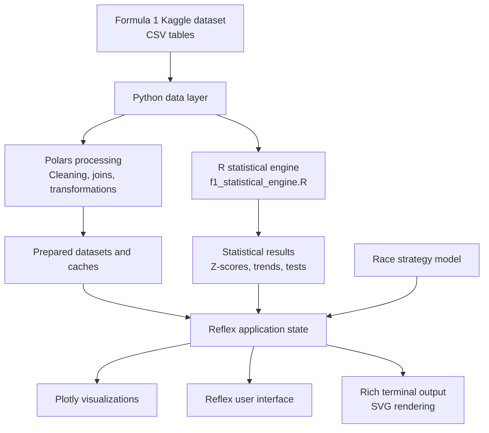

<div align="center">
🏎️ APEX // F1
Formula 1 World Championship Analytics & Race Strategy Platform
A data analysis and visualization project exploring Formula 1 history from 1950 to 2026.


Overview · Features · Architecture · Analytics · Installation · Dataset
</div>
---
📌 Overview
APEX // F1 is an interactive Formula 1 data analysis and visualization platform built to explore more than seven decades of motorsport history. It transforms historical race data into an analytical experience where users can investigate driver performance, constructor dominance, circuit history, lap-time behaviour, and race-strategy trade-offs.
The project brings together two complementary parts of the data stack:
R powers the statistical engine — performing statistical calculations and analysis such as within-season Z-score normalization, trend estimation, and hypothesis testing.
Python and Reflex power the application — coordinating the data pipeline, managing application state, and presenting the results through an interactive web interface.
Python's data ecosystem, including Polars, supports efficient tabular processing and relational joins. Plotly provides interactive charts, while Rich is used to create terminal-style telemetry output that can be rendered as SVG.
Rather than treating Formula 1 statistics as isolated records, APEX // F1 connects the data to questions such as:
How can a driver's performance be compared across seasons with different points systems?
Which constructors have dominated particular periods of Formula 1 history?
How have lap-time distributions changed across engine eras?
Which circuits have hosted the most races?
How do fuel load and tyre degradation influence a simulated race stint?
> **Project focus:** Data analysis, statistical computing, data engineering, and interactive visualization — brought together in a Formula 1-themed analytical platform.
✨ Project highlights
Area	What the project explores
Historical analysis	Formula 1 race, driver, constructor, and championship data across 1950–2026
Driver comparison	Season-normalized performance, career wins, and a composite dominance index
Constructor analysis	Season victories, historical win share, dynasties, and decade-level consistency
Lap-time analysis	Lap pace distributions, outlier filtering, and comparisons across engine eras
Circuit analysis	Circuit longevity, race-hosting frequency, and geographic locations
Race strategy	An interactive model of fuel-mass penalties and tyre degradation over a stint
Interactive application	A Reflex web interface with Plotly charts and a terminal-inspired telemetry panel
The source dataset contains approximately 76 years of championship history, with hundreds of thousands of lap-time records in the supplied data snapshot. Exact row counts can vary between dataset releases.
---
🏁 Key features
1. Dynasties & constructor performance
Explore how competitive eras have shifted between Formula 1 constructors.
Historical bar-chart race: Move through championship seasons and observe changes in cumulative constructor victories.
Season victory comparisons: Compare constructor wins across individual seasons.
Dynasty and win-share views: Examine how much of a season's competitive success is concentrated among leading constructors.
Decade consistency heatmap: Compare constructor win shares across decades, from the 1950s through the 2020s.
2. Driver greatness explorer
Driver statistics are presented with additional context to make comparisons across different seasons more meaningful.
Ranked driver views: Explore leading drivers by career victories and other performance measures.
Career wins vs. normalized dominance: Compare career success with a season-level Z-score measure.
Within-season normalization: Standardize a driver's points relative to the field in that season, rather than comparing raw points alone.
Composite dominance index: Combine peak performance, career consistency, and achievement-related inputs into one project-defined score.
3. Pace & engine-era analysis
Use historical lap-time records to investigate pace distributions and differences between broad power-unit eras.
Compare lap-time distributions across V10, V8, and hybrid periods.
Inspect pace variation using box plots and related statistical visualizations.
Explore stint-level pace decay and lap-time trends.
Apply data-cleaning and outlier-filtering steps before selected comparisons.
The lap-time analysis is limited to the period covered by the available lap-time table; it does not provide equivalent lap-by-lap telemetry for every season since 1950.
4. Circuit longevity & geography
Explore the venues that have shaped Formula 1 history.
Identify frequently used circuits.
Compare the number of races hosted at different venues.
Display circuit locations using latitude and longitude data.
Explore the historical presence of circuits such as Monza and Monaco.
5. Interactive race-strategy simulator
The simulator provides an interactive way to explore how fuel load and tyre age can influence lap pace over a race stint.
Inputs and controls include:
Circuit selection with project-defined clean-air lap-time baselines.
Tyre compound selection: Soft (C5), Medium (C3), or Hard (C1).
Stint length and lap-by-lap pace projection.
Fuel-load burn-off and its modeled lap-time effect.
A projected stint trajectory and a dynamic stint-condition indicator.
The simulator uses an illustrative engineering model. Its compound degradation parameters and fuel assumptions should be treated as modeling choices, not as official FIA or team telemetry.
6. Pit-wall terminal console
A terminal-inspired panel gives the application a motorsport engineering feel.
Styled as a macOS-like console with familiar window controls.
Uses Python's `rich` library to create formatted terminal output.
Exports terminal output as SVG for display in the interface.
Includes an interactive action to run the telemetry workflow again.
---
🧱 Technology stack
The project uses R for statistical analysis and a Python-based web application for data handling, state management, and visualization.
Technology	Role in APEX // F1
R	Statistical engine for normalization, statistical analysis, and trend calculations
Python	Application logic, data orchestration, and integration between components
Reflex	Reactive web application framework and UI state management
Polars	Tabular data processing, transformations, and relational joins
Plotly	Interactive charts and data visualizations
Rich	Styled terminal output and SVG telemetry rendering
Git	Version control
Why use both R and Python?
R and Python serve different purposes in this project:
R is the analytical layer. It is used for statistical methods that benefit from a dedicated statistical-computing workflow.
Python is the application layer. It loads and prepares data, connects the statistical workflow to the application, manages interactive state, and serves the web experience through Reflex.
Reflex connects the analysis to the user. It allows charts, controls, and simulator inputs to respond to user interaction without building a separate frontend in JavaScript.
This separation keeps the statistical work distinct from the presentation layer while allowing both to operate as one application.
---
🏛️ System architecture
The application follows a data-to-insight workflow: source CSV files are processed, analytical calculations are performed, and the resulting values are displayed in the interactive Reflex interface.

Architecture layers
Layer	Main components	Responsibility
Data source	Kaggle CSV dataset	Historical race, driver, constructor, circuit, standings, and lap-time records
Data processing	Python, Polars	Load, clean, join, transform, and prepare relational data
Statistical analysis	R	Run statistical calculations and produce normalized analytical measures
Application logic	Reflex state, Python	Manage user input, chart selection, cached results, and simulator state
Visualization	Plotly, Reflex, Rich	Present interactive charts, dashboards, and terminal-style telemetry
---
📐 Statistical methodology
A central challenge in historical Formula 1 analysis is that the sport has not used one consistent scoring system throughout its history. Race calendars, points allocation, regulations, and competitive conditions have changed over time. Directly comparing raw season points can therefore be misleading.
APEX // F1 uses statistical methods to add context to the comparisons.
1. Within-season Z-score normalization
A driver's season points are standardized against the distribution of points scored by the drivers in that same season.
For season `t`:
(X_{i,t}) is the points total for driver `i` in season `t`.
(\mu_t) is the mean points total for the season.
(\sigma_t) is the standard deviation of season points.
(Z_{i,t}) is the standardized score for the driver.
[
Z_{i,t} = \frac{X_{i,t} - \mu_t}{\sigma_t}
]
The season mean and standard deviation are calculated as:
[
\mu_t = \frac{1}{N_t}\sum_{i=1}^{N_t}X_{i,t}
]
[
\sigma_t = \sqrt{\frac{1}{N_t-1}\sum_{i=1}^{N_t}(X_{i,t}-\mu_t)^2}
]
Why it matters: A Z-score expresses how far a driver's points total is from the season's average in standard-deviation units. It provides a relative, within-season measure that is more informative for cross-era exploration than raw points alone. It does not remove every difference between eras or make the seasons perfectly equivalent.
2. Composite driver dominance index
The project defines a composite index that combines peak dominance, average career performance, and achievement-related inputs:
[
\begin{aligned}
\text{Dominance Index} ={}& 0.45Z_{\text{peak}} \
&+ 0.35\bar{Z}{\text{career}} \
&+ 0.20\ln(1 + 2W{\text{total}} + 5T_{\text{total}})
\end{aligned}
]
Where:
(Z_{\text{peak}}) represents the driver's peak season-level normalized performance.
(\bar{Z}_{\text{career}}) represents average normalized performance over the career seasons included in the calculation.
(W_{\text{total}}) represents total wins.
(T_{\text{total}}) represents the title-count input used by the project.
The weights are part of the project's scoring design. The index is a comparative analytical measure, not an official Formula 1 ranking.
3. Fuel-mass lap-time penalty
The simulator estimates the lap-time penalty associated with fuel carried by the car:
[
\Delta t_{\text{fuel}} = \left(\frac{m_{\text{fuel}}}{10}\right) \times 0.33\text{ seconds}
]
The current model assumes fuel burn-off of approximately 1.60 kg per lap. These values are simulator assumptions and should not be interpreted as universal values for every circuit, car, or regulation era.
4. Non-linear tyre degradation model
The simulator models a gradual increase in lap time as a tyre stint ages, followed by a steeper loss after a configured degradation threshold.
[
\Delta t_{\text{tyre}}(l) =
\begin{cases}
l,r_{\text{deg}}, & l \leq L_{\text{cliff}} \
L_{\text{cliff}}r_{\text{deg}} + (l-L_{\text{cliff}})^{1.6}(2.2r_{\text{deg}}), & l > L_{\text{cliff}}
\end{cases}
]
Where:
`l` is the tyre stint age in laps.
`r_deg` is the compound's baseline degradation rate.
`L_cliff` is the configured point at which the model increases the degradation penalty.
This is a simplified, non-linear model designed to make strategy trade-offs explorable. Real tyre behaviour depends on many additional variables, including track temperature, driving style, setup, traffic, and tyre construction.
5. Statistical hypothesis testing
The project includes a one-way ANOVA comparison of lap-time groups across selected engine eras.
Hypotheses:
[
H_0: \mu_{V10}=\mu_{V8}=\mu_{Hybrid}
]
[
H_1: \text{At least one group mean differs}
]
The supplied project analysis reports:
Statistic	Reported result
ANOVA F-statistic	42.98
p-value	(2.51 \times 10^{-19})
Significance threshold	(\alpha = 0.001)
The reported p-value is below the selected significance threshold, indicating evidence of a difference between at least some of the group means under the test's assumptions. ANOVA by itself does not identify which pairs of groups differ; that requires an appropriate post-hoc comparison.
6. Grid position and finishing position correlation
The project also reports a Pearson correlation analysis between grid position and race finishing position.
Statistic	Reported result
Pearson correlation (`r`)	0.451
p-value	(< 1.0 \times 10^{-15})
Sample size (`N`)	26,002 race entries
The positive correlation indicates that larger grid-position numbers tend to be associated with larger finishing-position numbers in the analyzed entries. Correlation describes association; it does not establish causation.
---
🗃️ Dataset
Source
The project uses the Formula 1 World Championship dataset published on Kaggle:
Formula 1 World Championship (1950–2026) — Kaggle
The dataset is organized as multiple related CSV files. These tables can be connected through identifiers such as race IDs, driver IDs, constructor IDs, and circuit IDs.
Primary tables used
The following table describes the primary datasets documented in the project. Row totals refer to the supplied dataset snapshot and may change when the Kaggle dataset is updated.
File	Approx. records in project notes	Coverage	Analytical use
`races.csv`	1,168	1950–2026	Grand Prix dates, seasons, rounds, and race information
`results.csv`	26,270	1950–2026	Race results, grid positions, points, and race status
`lap_times.csv`	636,495	1996–2026	Lap-level timing for pace and stint analysis
`drivers.csv`	835	1950–2026	Driver names, nationalities, and abbreviations
`constructors.csv`	206	1950–2026	Constructor identities and information
`circuits.csv`	79	1950–2026	Circuit details and geographic coordinates
`constructor_standings.csv`	13,681	1958–2026	Constructor championship standings
`driver_standings.csv`	35,025	1950–2026	Driver championship standings and points progression
The repository's `Dataset/` directory is organized around the supplied CSV files. The project notes identify 15 relational CSV tables in the complete dataset, while the table above lists eight primary tables used to describe the main analysis.
Important data considerations
Lap-time coverage: The supplied `lap_times.csv` data begins in 1996. The project therefore cannot perform the same lap-by-lap pace analysis for every season from 1950 onward.
Changing points systems: Formula 1 scoring rules have changed over time. Raw point totals should be interpreted in the context of the relevant season; the within-season normalization is intended to help with this comparison.
Tyre compound history: The simulator's Soft (C5), Medium (C3), and Hard (C1) options are simplified modeling inputs. They are not a complete historical record of the compounds used in every race.
Dataset updates: Kaggle dataset contents and row counts may change. Results should be interpreted against the exact dataset snapshot used when the analysis was run.
Statistical interpretation: Statistical significance does not automatically imply practical significance, causation, or a complete explanation of differences between eras.
---
⚡ Getting started
Follow these steps to run APEX // F1 locally.
Prerequisites
Python 3.10 or later (the project notes report testing with Python 3.11, 3.12, and 3.14).
R and `Rscript` available on your system path for the R statistical engine. The project notes describe a Python/Polars fallback for supported operations when R is unavailable.
Git.
The project dataset files in the expected `Dataset/` directory.
1. Clone the repository
```bash
git clone https://github.com/NishanthdevX/APEX-F1.git
cd APEX-F1
```
2. Create a virtual environment
```bash
python -m venv .venv
```
Activate it:
Windows — PowerShell
```powershell
.\.venv\Scripts\Activate.ps1
```
Linux / macOS
```bash
source .venv/bin/activate
```
3. Install dependencies
```bash
python -m pip install --upgrade pip
pip install -r requirements.txt
```
4. Add the dataset
Make sure the Kaggle CSV files are available in the project's `Dataset/` directory. Download the dataset from the source link above if it is not already included in your local copy.
The expected layout begins similar to:
```text
APEX-F1/
└── Dataset/
    ├── circuits.csv
    ├── races.csv
    ├── results.csv
    ├── lap_times.csv
    ├── drivers.csv
    ├── constructors.csv
    └── ...
```
5. Check the analytical pipeline
```bash
python test_f1_engine.py
```
This runs the project's statistical/data-engine verification script.
6. Start the Reflex application
```bash
python -m reflex run
```
When the application starts, open:
Service	Local address
Reflex web interface	http://localhost:3000
Backend ping endpoint	http://localhost:8001/ping
> **Note:** The application may depend on the dataset being placed in the expected directory and on the R runtime being configured correctly. Check the terminal output if the statistical engine or data-loading step fails.
---
📂 Project structure
```text
APEX-F1/
│
├── .github/
│   ├── workflows/
│   │   ├── ci.yml                    # CI workflow
│   │   └── codeql.yml                # Code security analysis workflow
│   ├── ISSUE_TEMPLATE/
│   │   ├── bug_report.md
│   │   ├── feature_request.md
│   │   └── config.yml
│   ├── PULL_REQUEST_TEMPLATE.md
│   ├── CONTRIBUTING.md
│   ├── dependabot.yml
│   └── SECURITY.md
│
├── apex_f1/
│   ├── __init__.py
│   ├── apex_f1.py                    # Main Reflex application and page layout
│   ├── data_bridge.py                # Data processing, joins, caches, Rich SVG output
│   ├── state.py                      # Reflex state, chart data, and simulator logic
│   ├── styles.py                     # Theme, colors, and typography
│   └── components/
│       ├── __init__.py
│       ├── hero.py                   # Hero section and KPI presentation
│       ├── navbar.py                 # Navigation component
│       ├── scroll_story.py           # Visualization sections and chart switching
│       ├── pace_simulator.py         # Race strategy and stint simulator
│       ├── methodology.py             # Statistical methodology and data notes
│       └── rich_pitwall.py           # Terminal-inspired telemetry component
│
├── Dataset/                          # Kaggle Formula 1 CSV tables
│   ├── circuits.csv
│   ├── races.csv
│   ├── results.csv
│   ├── lap_times.csv
│   └── ...
│
├── r_analytics/
│   └── f1_statistical_engine.R       # R statistical engine
│
├── assets/
│   └── favicon.ico
│
├── requirements.txt                  # Python dependencies
├── rxconfig.py                       # Reflex configuration
├── test_f1_engine.py                 # Data/statistical engine tests
├── LICENSE
└── README.md
```
---
🎨 Visual design
APEX // F1 uses a dark, motorsport-inspired visual language. The interface combines glass-like surfaces, restrained accent colors, and typography intended to keep dense analytical information readable.
Design token	Value	Use
Carbon Void	`#0B0E14`	Main background
Midnight Slate	`#141923`	Surface and panel base
Glass Surface	`rgba(18, 24, 38, 0.72)`	Translucent cards
Scuderia Crimson	`#E10600`	Primary Formula 1 accent
Papaya Orange	`#FF8000`	McLaren-inspired accent
Silver Arrow	`#00D2BE`	Mercedes-inspired accent
Oracle Blue	`#3B82F6`	Blue chart accent
Heritage Cyan	`#64C4FF`	Secondary chart accent
Lotus Gold	`#F59E0B`	Highlight and caution accent
Sector Green	`#10B981`	Positive/optimal status accent
The theme is designed to support the motorsport atmosphere without making charts and data labels difficult to read.
---
🧪 Testing and verification
Run the available project checks before submitting changes:
```bash
python test_f1_engine.py
python -m reflex compile
```
The project includes a test/verification script for the data and statistical engine. The reported analysis outputs in this README describe the results recorded in the project notes; rerun the pipeline against your local dataset snapshot to reproduce them.
---
⚠️ Limitations and responsible interpretation
Historical comparisons are not perfectly equivalent. Z-score normalization provides within-season context, but it cannot account for every difference in regulations, team strength, reliability, calendar length, or competitive environment.
Lap-time data is incomplete across the full historical period. The available lap-time table starts in 1996, so lap-level analysis is restricted to the seasons represented there.
The strategy simulator is not an official race simulator. Fuel penalties and tyre degradation are simplified assumptions used for exploration and demonstration.
The dominance index is project-defined. Its weights and inputs reflect this project's analytical design; it is not an official driver rating.
Statistical tests have assumptions. Group definitions, sample selection, outlier handling, and distribution characteristics affect the interpretation of statistical results.
Dataset versions matter. Different Kaggle releases may contain different records or corrections, which can change outputs.
---
🤝 Contributing
Contributions, suggestions, and improvements are welcome.
Fork the repository.
Create a feature branch: `git checkout -b feature/your-feature`.
Make your changes and add tests where appropriate.
Run the project checks:
```bash
   python test_f1_engine.py
   python -m reflex compile
   ```
Commit your work and open a pull request with a clear description of the change.
For project-specific conventions, see CONTRIBUTING.md if it is present in your checkout.
---
📚 Data attribution and license
Dataset attribution
The Formula 1 dataset used by this project is sourced from:
Samuel Pombourcq — Formula 1 World Championship 1950–2026 (Kaggle)
Please refer to the Kaggle dataset page for the dataset's current license, attribution requirements, and usage conditions. The project's software license does not automatically change or replace the license of third-party dataset contents.
Project license
The project source code is distributed under the GNU General Public License v3.0 (GPL-3.0). See the `LICENSE` file for the complete license text.
Disclaimer
APEX // F1 is an independent educational and analytical project. It is not affiliated with, endorsed by, or sponsored by Formula 1, the FIA, or any Formula 1 team. Formula 1 names and related marks belong to their respective owners.
---
<div align="center">
Built with 🏁 for Formula 1 fans, data enthusiasts, and curious minds.
Turning decades of racing history into data, statistics, and insight.
</div>